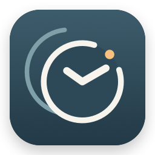

# 我的时区 · My Time Zone



**每个人都有自己的时区。**

迷茫的时候，看一眼时间，也提醒自己回到自己的节奏。

这是一款 macOS 独立网络时钟：系统时间被调快或调回时，依然可以查看真实时间，并看清两者的差异。

当前版本：**1.1.0**。支持 Apple Silicon，要求 macOS 15 或以上。

## 功能

- 真实时间与系统时间双时钟，可添加到桌面和通知中心。
- 统一切换 12／24 小时制，12 小时制标明 AM／PM。
- 网络校时结合连续计时，断网时沿用已取得的校准信息。
- 静默后台运行，手动再次打开 App 才显示设置，关闭窗口后继续计时。
- 可选的「登录 Mac 时启动」，以 macOS 的实际注册状态为准。
- 设置页显示 CPU、App 内存占比和基础硬件信息，仅页面可见时采样。

## 安装与升级

从本仓库的 [Releases](https://github.com/larryxiao27/true-world-time/releases) 下载 `MyTimeZone-1.1.0.dmg`。

1. 如旧版仍在运行，打开它的设置并选择「退出我的时区」。
2. 打开磁盘镜像，将「我的时区」拖入「应用程序」并替换旧版。
3. 启动后会静默校时；再次打开 App 可进入设置。
4. 首次使用时，在桌面或通知中心的「编辑小组件」中添加「我的时区」。已有组件继续沿用。
5. 如需登录启动，在设置中打开相应开关；若系统要求批准，按页面提示完成。

应用使用本地化显示名「我的时区」。为兼容既有组件、偏好设置和登录项，内部安装目录、Bundle Identifier 与 Widget kind 沿用原标识；命令行或显示全部扩展名时可能仍见 `TrueWorldTimeProbe.app`。

## 使用要求

首次校时需要互联网。应用不会调整系统日期或自动校时设置。请保持它在后台运行，小组件通过仅监听 `127.0.0.1` 的本机服务获取校准信息。

macOS 决定小组件的刷新时机；系统时间刚发生变化时，显示更新可能有短暂延迟。没有有效校准信息时会显示等待校时。

当前安装包采用本机代码签名，尚未完成 Apple Developer ID 签名与公证。网络下载后的安全检查由 macOS 决定；面向更广泛设备分发前，应完成正式签名与公证。

## 技术栈

| 模块 | 技术 |
|---|---|
| 界面与生命周期 | Swift 6、SwiftUI、AppKit |
| 小组件 | WidgetKit、TimelineProvider、TimeDataSource |
| 授时与计时 | SNTP、Darwin UDP、mach_continuous_time |
| 本机通信 | Network.framework、URLSession |
| 设置与登录启动 | UserDefaults、AppStorage、SMAppService |
| 资源状态 | host_statistics、getrusage、task_info、sysctl |
| 质量检查 | Swift Testing、ImageRenderer、Vision |

详细说明：[技术架构](docs/TECHNICAL_DESIGN.md) · [性能记录](docs/PERFORMANCE.md)

## 从源码构建

在仓库根目录执行：

```sh
swift test
bash scripts/package-probe.sh
```

构建脚本生成 Xcode 工程和 `dist/` 下的 DMG／ZIP。若 Xcode 首次组件安装未完成，会使用现有 Swift 编译器，并显式指定原生扩展入口。

`VERSION` 是发布版本来源。代码检查保留在 `Tests/`，本机日志、截图、证书和构建产物不提交。

```text
App/                  设置界面、后台生命周期与本机服务
AppSupport/           登录启动、资源计数器及按需采样
Widget/               原生双时钟组件
Sources/ClockCore/    独立校时、连续计时和显示锚点
Sources/ClockProbeCLI/ 命令行工具
Tests/                自动化检查
Resources/            应用图标与显示名称本地化
Assets/               图标预览与大尺寸导出
scripts/              构建、打包和检查工具
docs/                 架构、性能与发布说明
```

运行事件日志位于 `~/Library/Logs/TrueWorldTime/`。硬件采样不保存历史记录。
