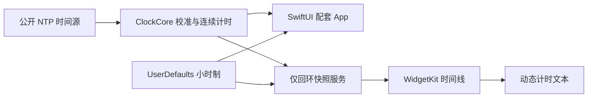

# 真世界时：技术栈与架构

## 目标和当前范围

目标是可添加到 Mac 桌面和通知中心的原生时钟小组件。真实时间独立于手动修改的系统时间；个人时区在真实时间上增加提前量。最终设计支持单/双时钟、指针/数字、瓷白/石墨黑以及 12/24 小时制。

0.5 为技术验证版：中号组件对照真实时间和系统时间，配套 App 提供后台校准、状态与统一小时制。个人偏移、完整外观和指针动画属于后续产品开发。

## 数据流



```text
真实 UTC = 上次校准 UTC + 连续时钟经过时长
系统偏差 = 系统 UTC - 真实 UTC
```

## 实际技术栈

| 技术 | 职责 |
|---|---|
| Swift 6、Swift Package Manager | 原生实现、共享核心、命令行验证和测试 |
| SwiftUI、AppKit | App 界面、休眠和唤醒事件 |
| WidgetKit | 原生组件、系统渲染和预计算时间线 |
| Foundation | 日历、时区、编码和固定格式静态时间 |
| Darwin UDP socket | SNTP 请求、超时与响应来源过滤 |
| `mach_continuous_time` | 包含休眠时长的连续计时 |
| Network、URLSession | 验证版 App 与组件之间的本机快照传输 |
| UserDefaults、AppStorage | 一个全局的持久化小时制设置 |
| Swift Testing | 协议、时间、格式与边界回归测试 |
| ImageRenderer、Vision | 无窗口渲染生产文本，识别数字并与参考值比较 |
| Xcode、swiftc、codesign、hdiutil | 构建、代码签名完整性检查和 DMG 打包 |

没有数据库、云后端、大模型调用或第三方运行依赖。

## 校时核心

客户端查询公开 NTP 服务，检查长度、版本、模式、同步状态、层级、请求标记、服务器时间戳和网络延迟；时间戳解码覆盖 2036 年后的 NTP era。

成功校准后，单调时钟推进真实 UTC。系统日期只用于比较偏差和生成组件显示锚点。网络失败时保留已有锚点并显示 `offlineHoldover`；没有有效锚点时显示 `unsynchronized`。估计的不确定度随样本年龄增加，不视为严格误差上界。

## 动态显示与小时制

早期用固定 GMT 显示时区表达校正值，实际 SwiftUI 动态文本受环境时区影响，而且不能可靠保留秒级精度。0.3 改为校准计时锚点：

```text
计时起点 = 系统采样时间 - 需要显示的本地时分秒所代表的秒数
```

0.4 两列都使用系统内置持续时间数据源，避免一列跟随地区设置而另一列固定为 24 小时制。

- 24 小时制：00–23。
- 12 小时制：01–12，分别标明 AM/PM。
- 两列可能处在不同半天，例如真实时间 11:55 AM、系统时间 12:05 PM，因此分别计算显示值和标签。
- 在两列较早的小时边界更新锚点，处理 12:59 → 01:00、午夜、正午和夏令时变化；预生成约一天的时间线。
- App 的设置保存后，请求小组件读取携带该设置的新快照。

## 验证版的数据共享

尚未使用 App Groups。配套 App 仅监听 `127.0.0.1:45931`，组件请求本地快照；服务不监听局域网。因此验证版需要 App 保持运行。

正式版本可在签名和容器配置齐备后评估 App Groups。共享数据不意味着组件持续运行，WidgetKit 仍由系统调度刷新。

## 后台生命周期

0.5 使用 `LSUIElement` 与 AppKit 的 accessory 激活策略隐藏 Dock 图标。AppKit delegate 持有长期运行的校时模型，首次启动不创建设置窗口；Finder/Spotlight 的 reopen 事件才显示 SwiftUI 设置界面。关闭窗口只收起，显式退出才停止进程。

系统改时、时区变化和唤醒通知触发刷新请求，并保留一秒的轻量改时检测兜底。只有窗口可见时才逐秒发布 UI 快照；取消逐秒诊断日志。设置窗口首次打开后会保留供快速重开，关闭窗口不意味着内存归零。

此版本不注册系统登录项。后台状态下 WidgetKit 请求是否及时执行，仍须实际验收；详见 [性能记录](PERFORMANCE.md)。

## 验证状态和边界

用户已确认 0.3 在真实系统调快后的数字显示正确。14 项自动化测试覆盖授时、时间推进、显示精度、午夜、夏令时以及小时制边界。离屏 SwiftUI 渲染用于检查生产显示代码，不代替原生宿主验收。

仍需完成系统调回、实际休眠、实际断网以及 0.4 设置切换的原生测试。`reloadAllTimelines` 是请求，不保证立即重绘；系统刚改时或主 App 退出时，组件可能暂时沿用旧锚点。这些条件是正式开发前的验收项。

## 参考资料

- [Apple：小组件刷新机制](https://developer.apple.com/documentation/widgetkit/keeping-a-widget-up-to-date)
- [Apple：TimeDataSource](https://developer.apple.com/documentation/swiftui/timedatasource)
- [Apple：创建 Widget 扩展](https://developer.apple.com/documentation/widgetkit/creating-a-widget-extension)
- [NIST：Internet Time Service](https://www.nist.gov/pml/time-and-frequency-division/time-distribution/internet-time-service-its)
- [Apple：LSUIElement 后台代理应用](https://developer.apple.com/documentation/bundleresources/information-property-list/lsuielement)
- [Apple：处理再次打开应用](https://developer.apple.com/documentation/appkit/nsapplicationdelegate/applicationshouldhandlereopen%28_%3Ahasvisiblewindows%3A%29)
